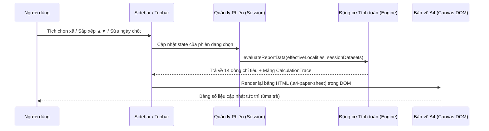

# Kiến trúc Giao diện Dual-Pane Live Studio (Phương án 5)

> **Tài liệu Kỹ thuật Kiến trúc UI/UX**  
> **Dự án:** KTXH Offline Report (`cavoixanh638/KTXD-report`)  
> **Quy chuẩn:** MASTER V2.2, Không CDN, Không Web Font, Hoạt động độc lập qua `file://`

---

## 1. Tổng quan Kiến trúc

Kiến trúc **Dual-Pane Live Studio** tổ chức không gian làm việc thành 3 vùng chuyên biệt phối hợp chặt chẽ theo mô hình phản ứng tức thì (Zero-Latency Reactive Architecture):

```
+---------------------------------------------------------------------------------------------------------+
|                                              TOPBAR (46px)                                              |
| [|] Bật/tắt Sidebar | Phiên: [Dropdown v] [Sửa tên] [Sao lưu] [Phục hồi] | [In / PDF] [Xuất XLSX]      |
+--------------------------+------------------------------------------------------+-----------------------+
|  SIDEBAR TRÁI (332px)    |                CANVAS TRUNG TÂM                      |  NGĂN KÉO VẾT TÍNH    |
|  (Thu gọn về 0px khi cần)|                (Cuộn 2 chiều)                        |  (Drawer trượt phải)  |
|                          |                                                      |                       |
| 1. Nguồn Dữ liệu & Ngày  |   +----------------------------------------------+   |  Chi tiết ô số liệu:  |
|    DISB / REV / GPMB     |   |          TỜ BÁO CÁO A4 IN NGANG              |   |  - Công thức tính     |
|    (Riêng từng phiên)    |   |          (297mm x 210mm, Nền trắng,          |   |  - Tử số / Mẫu số     |
|                          |   |           Times New Roman chuẩn CVHC)        |   |  - Tập hợp included   |
| 2. Địa phương & Thứ tự   |   |                                              |   |  - Lý do excluded     |
|    - Ô tìm kiếm không dấu|   |   BẢNG CHỈ TIÊU KTXH (14 DÒNG CHUẨN)         |   |  - Nguồn file & SHA   |
|    - Hộp kiểm kèm #1..N  |   |   +------+-------+-------+-------+           |   |                       |
|    - Nút mũi tên [▲] [▼] |   |   | TT   | Chỉ...| Toàn..| Xã A  | ...       |   |                       |
|                          |   |   +------+-------+-------+-------+           |   |                       |
| 3. Tùy chỉnh Bảng in     |   |                                              |   |                       |
|    - Tiêu đề báo cáo     |   +----------------------------------------------+   |                       |
|    - Bật/tắt dòng 2,3,8,9|                                                      |                       |
|    - Cỡ chữ, ngắt trang 2|                                                      |                       |
+--------------------------+------------------------------------------------------+-----------------------+
```

---

## 2. Chi tiết 4 Vùng Giao diện

### 2.1. Thanh điều khiển trên cùng (Topbar — 46px)
- **Nút Bật/tắt Sidebar (`#btn-toggle-sidebar`)**:
  - Dùng icon SVG `iconSidebarToggle` hiển thị trạng thái hai cột.
  - Phím tắt bàn phím: `Ctrl + B` (hoặc nhấn trực tiếp).
  - Khi bật/tắt, thêm hoặc gỡ class `.sidebar-collapsed` trên vùng chứa gốc `#studio-shell`.
- **Bộ chuyển đổi Phiên làm việc (Session Switcher)**:
  - Dropdown danh sách các phiên đang lưu trong bộ nhớ máy.
  - Nút thêm phiên mới (`+`), nhân bản phiên (`Nhân bản`), xóa phiên.
- **Nút Đổi tên phiên (`#btn-topbar-rename-session`)**:
  - Mở hộp thoại modal cho phép sửa tên hiển thị của phiên (ví dụ: *Báo cáo Họp Ban Thường vụ Tháng 10*).
- **Sao lưu & Phục hồi (`#btn-topbar-backup`, `#btn-topbar-restore`)**:
  - Tải file sao lưu mã hóa kiểm tra `.kxh.json` về máy hoặc tải lên để khôi phục trạng thái.
- **Tác vụ Xuất kết quả**:
  - `In / Lưu PDF`: Mở hộp thoại in trình duyệt, tự động kích hoạt CSS `@media print` cho khổ A4 ngang.
  - `Xuất Excel`: Tạo file `.xlsx` gồm 5 sheet kiểm toán chuẩn.

---

### 2.2. Cột điều khiển bên trái (Left Sidebar — 332px)
Sidebar được chia thành 3 khối thẻ (Cards) xếp theo thứ tự quy trình công tác:

#### Khối 1: Nguồn Dữ liệu & Ngày chốt số liệu (Data Sources)
- **Độc lập theo từng phiên**: Mỗi phiên lưu cấu hình `datasetOverrides` riêng biệt. Phiên 1 có thể dùng file Excel tháng 9, Phiên 2 dùng file Excel tháng 10.
- **Thẻ 3 nguồn dữ liệu**:
  1. `DISB` — Báo cáo Giải ngân đầu tư công.
  2. `REV` — Báo cáo Thu ngân sách nhà nước.
  3. `GPMB` — Báo cáo Giải phóng mặt bằng.
- **Các thành phần trong mỗi thẻ nguồn**:
  - Tên file đang dùng và ngày cập nhật.
  - Nút `Chọn file Excel khác`: Cho phép nạp file mới cục bộ (không gửi lên mạng).
  - Bộ chọn dataset đã lưu trong máy: Dễ dàng chuyển đổi giữa các file đã nạp.
  - Ô chỉnh sửa ngày chốt số liệu (`asOfDate`): Hiển thị cảnh báo nếu ngày cần xác nhận.
  - Thống kê độ phủ: Số xã/phường có số liệu trên tổng số địa phương.

#### Khối 2: Lựa chọn & Sắp xếp Địa phương (Locality Selector & Reordering)
- **Ô tìm kiếm tức thì**: Hỗ trợ gõ tiếng Việt có dấu hoặc không dấu (ví dụ: gõ `binh giang` tìm ra `Xã Bình Giang`).
- **Thống kê chọn lọc**: Hiển thị số lượng đã chọn (ví dụ: `Đã chọn: 5 / 114`).
- **Danh sách hộp kiểm tích hợp thứ tự (Inlined Reordering List)**:
  - Mỗi hàng đại diện cho 1 địa phương.
  - Tên địa phương tự động lọc bỏ các huy hiệu loại hình thừa thãi khi tên đã chứa tiền tố rõ ràng.
  - Khi được tích chọn, ngay cạnh tên sẽ xuất hiện:
    - **Huy hiệu số thứ tự cột** (ví dụ: `1`, `2`, `3`...).
    - **Nút di chuyển lên `▲`**: Đưa cột địa phương sang trái trong bảng báo cáo.
    - **Nút di chuyển xuống `▼`**: Đưa cột địa phương sang phải trong bảng báo cáo.
  - Khi bỏ tích chọn, huy hiệu số thứ tự tự động biến mất và thứ tự các địa phương còn lại được đánh số lại liên tục.

#### Khối 3: Tùy chỉnh Bảng báo cáo (Report Display Options)
- **Tiêu đề báo cáo**: Ô nhập văn bản thay đổi trực tiếp tiêu đề chính (mặc định: *KẾT QUẢ TỔNG HỢP MỘT SỐ CHỈ TIÊU KTXH CỦA CÁC XÃ, PHƯỜNG*).
- **Phụ đề báo cáo**: Ô nhập văn bản hiển thị kỳ báo cáo (ví dụ: *Tháng 10 năm 2026*).
- **Hộp kiểm bật/tắt các dòng chỉ tiêu linh hoạt**:
  - Dòng 2: *Tổng số vốn đã phân bổ theo kế hoạch năm*.
  - Dòng 3: *Tổng số vốn giải ngân*.
  - Dòng 8: *Số dự án chưa hoàn thành công tác GPMB*.
  - Dòng 9: *Danh sách các dự án chưa hoàn thành*.
- **Tùy biến hiển thị chuyên sâu**:
  - Độ rộng cột địa phương (mặc định `88px`).
  - Cỡ chữ chi tiết dự án (dòng 9) để đảm bảo không bị tràn trang khi in (`10px` / `11px`).
  - Ngắt dòng 8 & 9 sang Trang 2 (Page 2) khi danh sách dự án dài.

---

### 2.3. Bàn vẽ trực tiếp trung tâm (Center Canvas)
- **Nền xám công tác (`#eef2f6`)**: Tương phản cao, làm nổi bật trang giấy in trắng.
- **Tờ báo cáo A4 (`.a4-paper-sheet`)**:
  - Mô phỏng chính xác kích thước trang in thực tế (`297mm x 210mm`).
  - Phông chữ hành chính chuẩn mực: `Times New Roman`, màu chữ `#111827`, căn lề và đường kẻ bảng theo đúng mẫu bảng biểu công văn.
- **Bảng 14 dòng chỉ tiêu chuẩn**:
  - Cột 1: Số thứ tự La Mã / Số hiệu.
  - Cột 2: Nội dung chỉ tiêu (kèm ngày chốt số liệu in đậm rõ nét).
  - Cột 3: Toàn huyện / Toàn thành phố (Benchmark trung bình chuẩn tính bằng `SUM/SUM`).
  - Cột 4..N: Từng xã, phường được chọn theo đúng thứ tự đã sắp xếp.
- **Tương tác trực tiếp trên ô số liệu (Click-to-Inspect)**:
  - Nhấp vào bất kỳ ô số liệu nào trên bảng sẽ tự động mở **Cửa sổ soi vết tính toán** (Popover tại chỗ hoặc Drawer bên phải).

---

### 2.4. Ngăn kéo Soi vết Tính toán (Right Trace Drawer & Popover)
- Cung cấp tính năng giải trình minh bạch số liệu (`CalculationTrace`):
  - **Tên chỉ tiêu và Địa phương**: Hiển thị rõ ô đang soi.
  - **Công thức tính toán**: Hiển thị bằng ký hiệu toán học chuẩn (ví dụ: `SUM(giải ngân) / SUM(kế hoạch) * 100`).
  - **Giá trị tử số và mẫu số**: Từng thành phần số học cụ thể.
  - **Tập hợp đưa vào tính (`includedLocalities` / `includedProjects`)**: Danh sách các xã hoặc dự án được tính.
  - **Tập hợp bị loại trừ (`excludedLocalities` / `excludedProjects`)**: Kèm lý do kỹ thuật cụ thể (ví dụ: `Mẫu số bằng 0`, `Không có dữ liệu trong kỳ`).
  - **Nguồn trích xuất**: Tên file Excel gốc, tên Sheet, địa chỉ ô hoặc vùng dữ liệu, mã SHA-256 xác thực.

---

## 3. Kiến trúc Cách ly Nguồn Dữ liệu theo Từng Phiên (Per-Session Dataset Isolation)

Trong các cơ quan, mỗi cán bộ có thể phụ trách nhiều kỳ báo cáo khác nhau (ví dụ: *Phiên 1: Báo cáo định kỳ tháng 9; Phiên 2: Báo cáo nhanh giữa tháng 10; Phiên 3: Báo cáo rà soát địa bàn A*).

Kiến trúc KTXH Offline tách biệt hoàn toàn dữ liệu giữa các phiên thông qua mô hình:

```
[Local IndexedDB / Storage]
  ├── Dataset DISB #1 (15/10/2026)
  ├── Dataset DISB #2 (30/10/2026)
  ├── Dataset REV #1 (Tháng 9)
  ├── Dataset REV #2 (Tháng 10)
  └── Dataset GPMB #1 (26/12/2026)

[ReportSession: Phiên Tháng 9]           [ReportSession: Phiên Tháng 10]
  ├── datasetOverrides:                    ├── datasetOverrides:
  │     DISB -> Dataset DISB #1            │     DISB -> Dataset DISB #2
  │     REV  -> Dataset REV #1             │     REV  -> Dataset REV #2
  │     GPMB -> Dataset GPMB #1            │     GPMB -> Dataset GPMB #1
  ├── asOfDates:                           ├── asOfDates:
  │     DISB: 15/09/2026                   │     DISB: 15/10/2026
  │     REV:  30/09/2026                   │     REV:  19/10/2026
  └── selectedLocalities: [Xã A, Xã B]     └── selectedLocalities: [Xã C, Xã D, Xã E]
```

### Các hàm cốt lõi quản lý liên kết dữ liệu (`src/core/sessions.ts`):
1. `rebindSessionDataset(session, sourceId, datasetId)`: Gán một bộ dữ liệu cụ thể cho phiên hiện tại mà không làm ảnh hưởng phiên khác.
2. `clearSessionDatasetBinding(session, sourceId)`: Đưa phiên về sử dụng dataset mặc định của hệ thống.
3. `updateDatasetAsOfDateForSession(session, sourceId, newDate)`: Thay đổi ngày chốt số liệu cục bộ trong phiên.
4. `getSessionLocalitiesBaseline(session, catalog, storage)`: Truy xuất danh mục địa phương dựa trên chính bộ dữ liệu DISB mà phiên đó đang liên kết.

---

## 4. Chu trình Phản ứng Dữ liệu (Reactivity Lifecycle)

Mỗi tương tác của người dùng trên Sidebar hoặc Topbar kích hoạt chu trình khép kín:



Toàn bộ quy trình diễn ra hoàn toàn trong bộ nhớ RAM trình duyệt, không thông qua bất kỳ network request nào, đảm bảo tốc độ đáp ứng tức thì và độ an toàn tuyệt đối.
