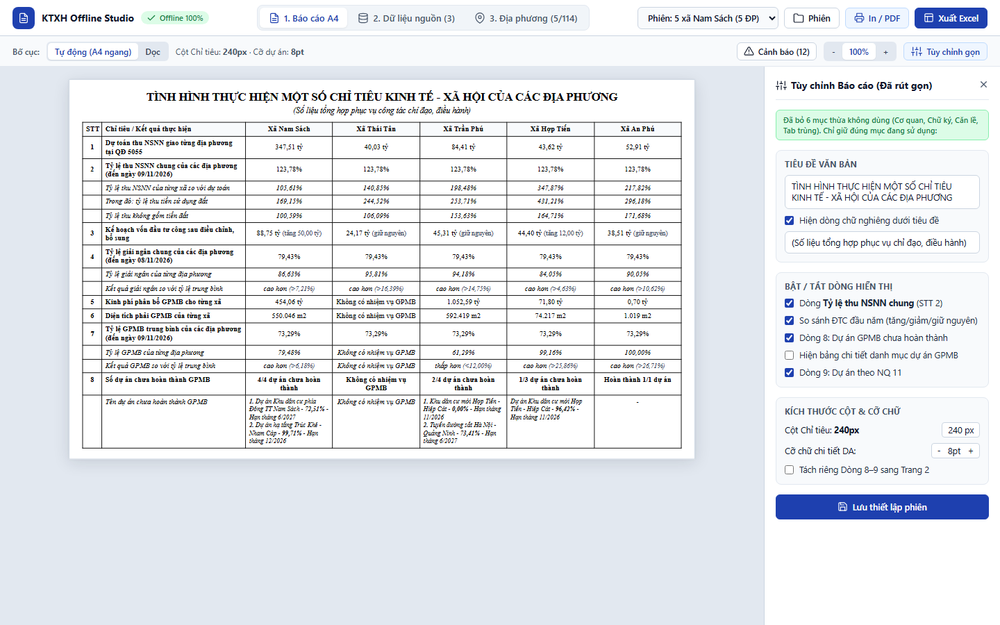
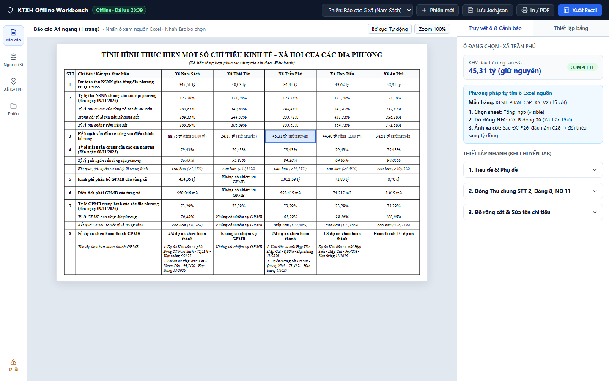
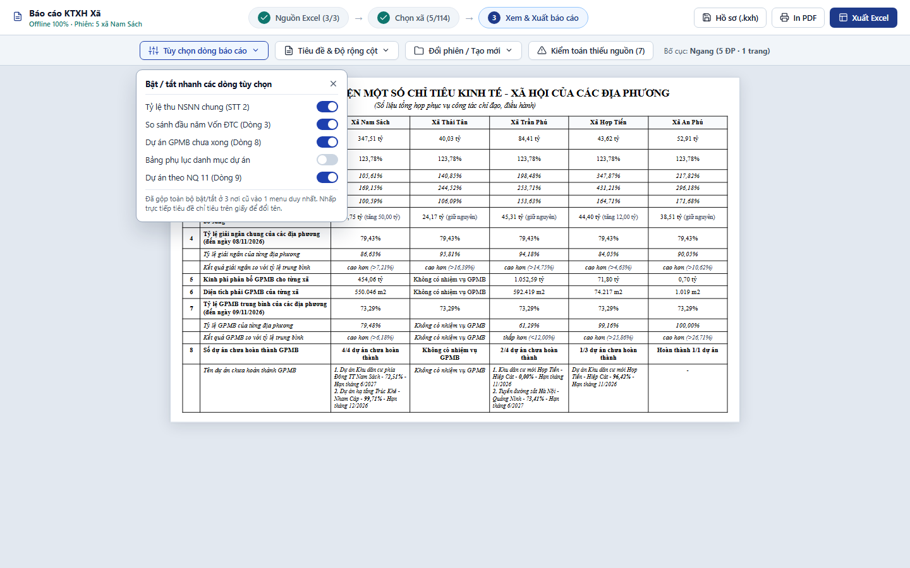
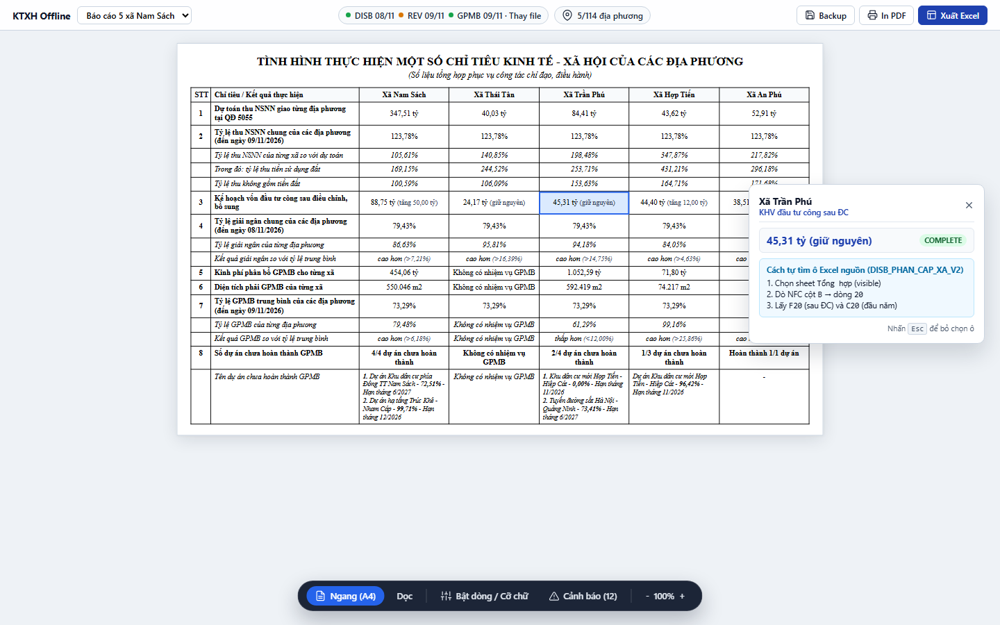
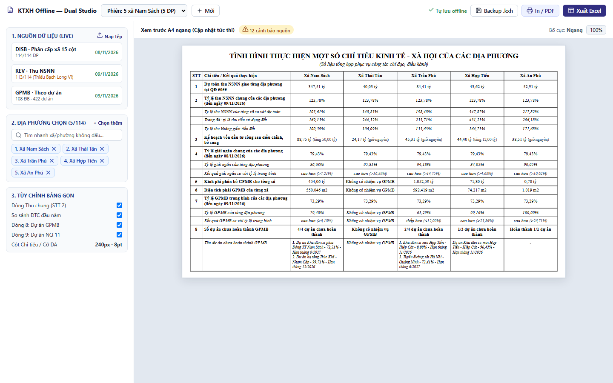
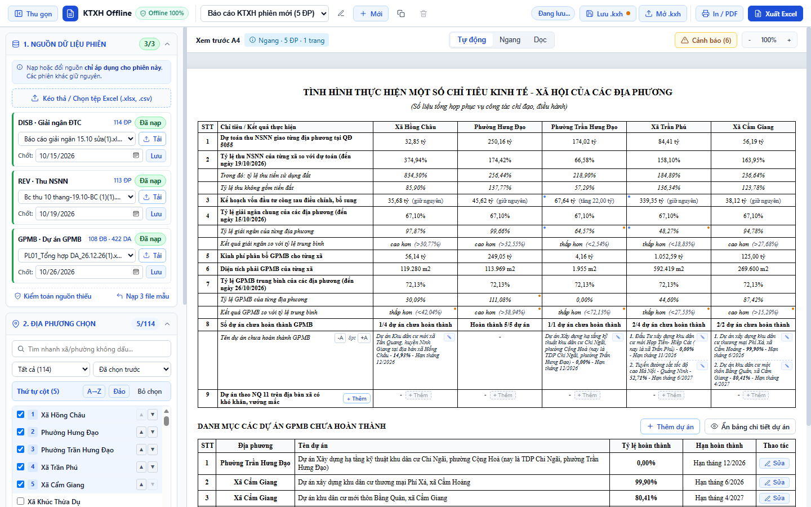
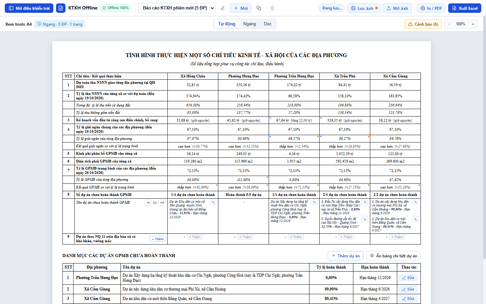

# Báo cáo Đánh giá & So sánh 5 Phương án Thiết kế Giao diện KTXH Offline

> **Ngày lập:** 14/11/2026  
> **Dự án:** KTXH Offline Report (`cavoixanh638/KTXD-report`)  
> **Tiêu chuẩn áp dụng:** MASTER V2.2, Không CDN, Không Web Font, Báo cáo chuẩn hành chính A4 ngang, Phím tắt, WCAG 2.1 AA.

---

## 1. Bối cảnh & Mục tiêu Thiết kế lại

Hệ thống KTXH Offline là ứng dụng desktop offline 100% (chạy trực tiếp bằng `file://` qua trình duyệt Microsoft Edge / Google Chrome) phục vụ cán bộ công chức tổng hợp số liệu kinh tế - xã hội các xã, phường, đặc khu từ 3 nguồn Excel (Giải ngân DISB, Thu ngân sách REV, Giải phóng mặt bằng GPMB).

### Vấn đề của giao diện ban đầu (Phiên bản V1):
1. **Quá nhiều trường thông tin hành chính ít dùng**: Cung cấp tới 6 ô nhập liệu tiêu đề, căn lề, cỡ chữ, đơn vị cấp trên, khu vực chữ ký làm rối mắt người dùng.
2. **Trùng lặp thao tác**: Danh sách xã xuất hiện ở 2 nơi (khối danh sách hộp chọn và thanh chip sắp xếp thứ tự cột riêng biệt phía trên).
3. **Thao tác thừa**: Nút mở bảng điều khiển xuất hiện lặp lại ở cả Topbar và đầu Canvas xem trước.
4. **Không gian xem trước bị chật**: Bảng điều khiển cố định chiếm diện tích, khiến việc đối soát bảng báo cáo rộng trên màn hình laptop gặp khó khăn.

Để giải quyết triệt để, 5 phương án thiết kế hoàn toàn khác biệt đã được phác thảo và đánh giá:

---

## 2. Chi tiết & Đánh giá 5 Phương án Thiết kế

### Phương án 1: Swiss Minimalist (Đơn sắc, Tối giản, Menu ngang mỏng)
- **Cấu trúc:** Thanh công cụ phía trên mỏng (Sub-header) chứa các nút thả xuống (Dropdown popovers). Toàn bộ diện tích phía dưới dành cho tờ A4.
- **Ưu điểm:**
  - Tối đa hóa diện tích xem trước bảng dữ liệu (chiếm 95% màn hình).
  - Giao diện phẳng, tinh gọn, hiện đại.
- **Nhược điểm:**
  - Mỗi lần muốn đổi xã hay đổi nguồn phải nhấp chuột mở Popover rồi mới chọn được, thiếu tính trực quan tức thì.
  - Khó kiểm soát nhiều thông số cùng lúc khi đang đối soát số liệu.

---

### Phương án 2: Enterprise Workbench Rail (Thanh Icon thanh mảnh bên trái + Drawer trượt)
- **Cấu trúc:** Một thanh dock hẹp 56px chứa các icon chức năng (Phiên, Dữ liệu, Địa phương, Bố cục, Xuất). Nhấp vào icon nào sẽ trượt mở ngăn kéo (Drawer) chứa cài đặt tương ứng.
- **Ưu điểm:**
  - Rất quen thuộc với người dùng các phần mềm chuyên nghiệp như VS Code, Figma, Slack.
  - Phân vùng chức năng rất rõ ràng, không bao giờ bị rối.
- **Nhược điểm:**
  - Phải chuyển đổi qua lại giữa các tab (Phiên $\leftrightarrow$ Nguồn $\leftrightarrow$ Xã), không quan sát được tổng thể một lượt.
  - Cần thêm thao tác nhấp chuột để đổi chế độ làm việc.

---

### Phương án 3: Guided Wizard Ribbon (Thanh Ribbon ngang dạng 4 bước kiểu MS Office)
- **Cấu trúc:** Thanh điều khiển trải ngang trên cùng với 4 bước tuyến tính: *Bước 1: Quản lý phiên $\rightarrow$ Bước 2: Nguồn dữ liệu $\rightarrow$ Bước 3: Chọn xã $\rightarrow$ Bước 4: Tùy chỉnh & Xuất*.
- **Ưu điểm:**
  - Quen thuộc với người làm việc văn phòng quen dùng Microsoft Word / Excel.
  - Dễ tiếp cận cho người mới dùng lần đầu.
- **Nhược điểm:**
  - Chiếm nhiều chiều dọc màn hình (Vertical Height), làm giảm không gian hiển thị của tờ báo cáo A4 vốn đã trải ngang.
  - Người dùng có kinh nghiệm cảm thấy bị gò bó theo quy trình tuần tự.

---

### Phương án 4: Canvas-Centric Dock (Bảng trôi nổi - Floating Inspector)
- **Cấu trúc:** Tờ giấy báo cáo A4 là trung tâm tuyệt đối của màn hình. Bảng công cụ điều khiển là một hộp nổi (Floating Island / Dock) ở góc dưới hoặc bên phải, có thể gập nhỏ thành thanh mini-bar.
- **Ưu điểm:**
  - Cảm giác thị giác rất thoáng đạt, tập trung hoàn toàn vào kết quả văn bản.
- **Nhược điểm:**
  - Hộp nổi dễ che khuất các cột số liệu hoặc ghi chú phía dưới của bảng báo cáo khi cuộn trang.
  - Kém tiện dụng trên màn hình máy tính có độ phân giải khiêm tốn (1366x768).

---

### Phương án 5: Dual-Pane Live Studio (Hai vùng làm việc song song: Cột điều khiển trái gập/mở + Bàn vẽ A4 trực tiếp)
- **Cấu trúc:**
  - **Cột trái (Sidebar 332px):** Gom toàn bộ 3 nhóm thao tác cốt lõi theo chiều dọc:
    - *Khối 1: Nguồn dữ liệu & Kỳ chốt số liệu độc lập theo phiên.*
    - *Khối 2: Danh sách địa phương (tìm kiếm không dấu, tích chọn, số thứ tự `1..N` và nút `▲`/`▼` sắp xếp trực tiếp).*
    - *Khối 3: Tùy chỉnh hiển thị bảng (bật/tắt dòng 2, 3, 8, 9, chỉnh độ rộng cột, cỡ chữ dự án, ngắt trang 2).*
  - **Nút bật/tắt Sidebar:** Nằm ngay trên Topbar, cho phép thu gọn hoàn toàn Sidebar về `0px` chỉ bằng 1 cú nhấp (hoặc phím tắt), giúp mở rộng 100% không gian màn hình khi cần đọc duyệt báo cáo lớn.
  - **Vùng phải (Canvas):** Mô phỏng chuẩn xác trang giấy in A4 ngang (`297mm x 210mm`) theo mẫu công văn hành chính với phông chữ Times New Roman. Mọi thao tác bên cột trái đều phản hồi tức thì (Zero-latency reactivity) lên tờ giấy.
- **Đánh giá:**
  - **Tối ưu nhất cho nghiệp vụ**: Cán bộ vừa tích chọn/sắp xếp xã vừa thấy bảng cập nhật ngay lập tức.
  - **Linh hoạt tối đa**: Mở Sidebar khi đang cấu hình, đóng Sidebar khi cần đối soát số liệu hoặc in ấn.

---

## 3. Quyết định Chọn & Tinh gọn Phương án 5

Người dùng đã quyết định chọn **Phương án 5 (Dual-Pane Live Studio)** kèm theo các yêu cầu tinh gọn sâu sắc:

1. **Lập tức gỡ bỏ tính năng thừa/ít dùng:**
   - Bỏ 6 trường nhập liệu hành chính không cần thiết (*Cơ quan cấp trên, Đơn vị ban hành, Căn lề tiêu đề, Cỡ chữ tiêu đề, In hoa tiêu đề, Khu vực ký tên*).
   - Bỏ hàng nút preset mẫu địa phương cố định (*5 xã, 7 phường, 11 xã, Tất cả, Về 0*) vì dữ liệu thực tế mỗi huyện/thị là động.
2. **Hợp nhất danh sách xã & tính năng sắp xếp:**
   - Xóa bỏ khối chip riêng biệt phía trên. Tích hợp huy hiệu số thứ tự `#1..N` và hai nút mũi tên `▲`/`▼` vào ngay cạnh tên mỗi xã trong danh sách hộp kiểm.
   - Bỏ tiền tố đơn vị hành chính trùng lặp (`Xã`, `P`, `ĐK`) khi tên xã đã có sẵn chữ "Xã", "Phường", "Đặc khu".
3. **Thống nhất nút điều khiển:**
   - Bỏ nút mở bảng điều khiển trùng lặp ở đầu Canvas, chỉ giữ lại một nút `[|] Bật/tắt điều khiển` duy nhất trên Topbar.
4. **Bổ sung quản lý phiên:**
   - Bổ sung nút đổi tên phiên làm việc trực tiếp ngay cạnh tên phiên trên Topbar.
   - Cách ly nguồn dữ liệu tuyệt đối theo từng phiên: mỗi phiên có thể dùng một bộ 3 file Excel hoàn toàn riêng biệt.

---

## 4. Bằng chứng Triển khai Thực tế

| Chế độ hiển thị | Ảnh chụp màn hình thực tế trên Edge Headless |
| :--- | :--- |
| **Sidebar đang mở (332px)** |  |
| **Sidebar đã thu gọn (0px)** |  |

Toàn bộ thiết kế đã được hiện thực hóa 100% trong mã nguồn `src/app/main.ts`, `src/styles/main.css`, `src/ui/reportStudio.ts` và được đóng gói thành file đơn `dist/index.html` chạy offline hoàn toàn.
